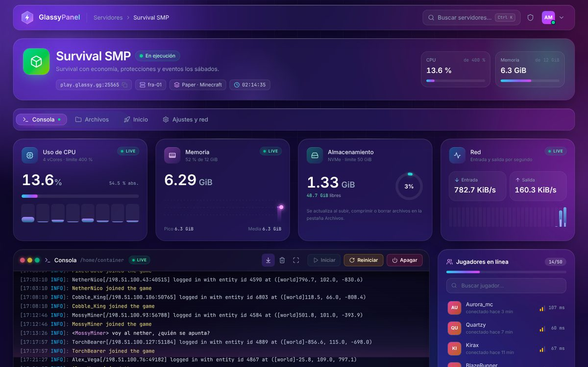
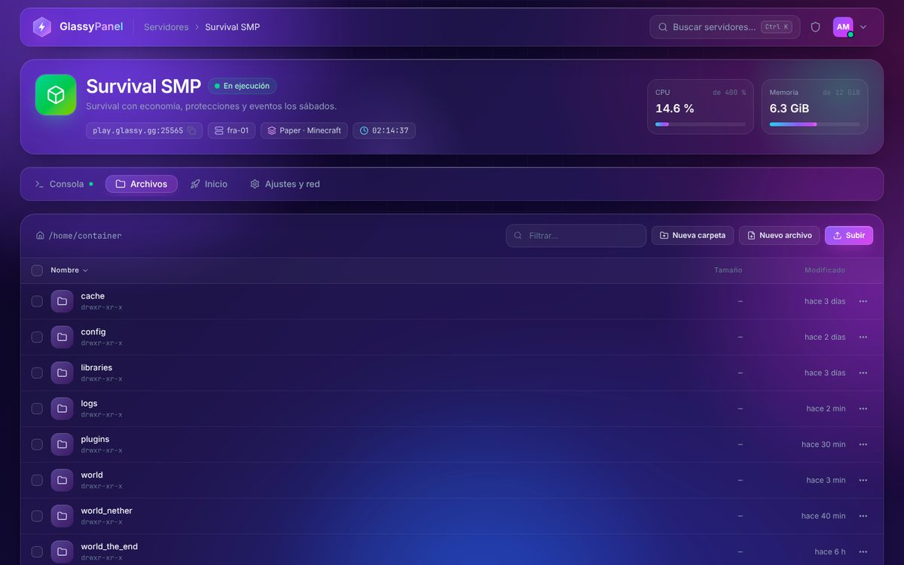

# Glassy · tema para Pterodactyl Panel

Vista de gestión de un servidor con estética **glassmorphism**, escrita como componentes de React + TypeScript + Tailwind CSS v4 con la misma estructura que `resources/scripts` de Pterodactyl 1.x.



## Qué incluye

Cuatro pestañas que cambian sin recargar la página. La consola, las gráficas y el resto de animaciones siguen funcionando en segundo plano mientras estás en otra pestaña.

| Pestaña | Contenido |
|---|---|
| **Consola** (`#/`) | Terminal con líneas de escaneo y barrido, colores ANSI, auto-scroll con aviso de «líneas nuevas», historial (↑/↓), autocompletado (`Tab`) y pantalla completa. Botones Iniciar / Reiniciar / Apagar; mientras se detiene, Apagar pasa a **Forzar** y pide confirmación, como en el panel. Métricas en vivo (CPU con carga por hilo, RAM con gráfica de historial, almacenamiento y red) y lista lateral de jugadores. |
| **Archivos** (`#/files/...`) | Explorador translúcido de `/home/container` con migas de pan, filtro, ordenación, iconos por tipo, selección múltiple y barra flotante de acciones. Menú flotante (botón ⋯ o clic derecho): editar, renombrar, duplicar, descargar, comprimir en .zip, descomprimir y eliminar. Subida con botón o arrastrando archivos, y editor en modal (`Ctrl+S`). |
| **Inicio** (`#/startup`) | Comando de arranque con vista previa en vivo, selector de imagen Docker (versión de Java) con aviso de compatibilidad, entorno del contenedor (memoria, IP y puerto asignado) y variables del egg con validación según sus reglas, interruptores para las booleanas y candado en las no editables. Barra flotante «Guardar cambios / Descartar». |
| **Ajustes y red** (`#/settings`) | Nombre y descripción, acceso SFTP, puertos (crear, notas, hacer principal, liberar), copias de seguridad (crear, bloquear, restaurar, eliminar) y reinstalación. |



## Vista previa

```bash
npm install
npm run dev     # servidor de desarrollo en http://localhost:5173
npm run build   # genera dist/index.html, un único archivo que se abre con doble clic
```

La vista previa no necesita un panel: `src/api/server.ts` y `src/socket/MockSocket.ts` simulan la API de cliente y el WebSocket de Wings. La simulación es coherente entre pestañas. Por ejemplo:

- Si pones `eula=false` en `eula.txt`, el siguiente arranque se detiene pidiendo aceptar el EULA.
- Si eliges Java 17 en Inicio, Paper 1.21.1 falla con `UnsupportedClassVersionError`.
- Si renombras `server.jar`, aparece `Unable to access jarfile`.
- Si cambias el puerto principal en Ajustes, se usa en el siguiente arranque.
- El disco usado en Consola refleja lo que subes o borras en Archivos.

## Estructura

```
src/
├── api/
│   ├── types.ts              Tipos de resources/scripts/api/server (Server, FileObject, ServerEggVariable…)
│   ├── server.ts             API simulada: mismos nombres y firmas que las funciones del panel
│   └── mock/db.ts            Datos de ejemplo (servidor, archivos, variables, puertos, copias)
├── socket/
│   ├── events.ts             SocketEvent / SocketRequest (protocolo de Wings)
│   └── MockSocket.ts         WebSocket simulado: console output, status, stats, install, backups
├── state/server.tsx          Almacén con la forma del ServerContext del panel + búfer de consola y estadísticas
├── hooks/                    useWebsocketEvent (copia del panel), useHashRoute, useSpotlight
├── components/
│   ├── elements/             Botón, GlassBox, Modal/ConfirmDialog, FloatingMenu, Toast, Switch, Field…
│   └── server/
│       ├── WebsocketHandler.tsx, NavigationBar.tsx, ServerHeader.tsx, SubNavigation.tsx
│       ├── console/          ServerConsoleContainer, Console, PowerButtons, StatBlocks, PlayerList
│       ├── files/            FileManagerContainer, FileObjectRow, FileEditorModal, FileNameModal, MassActionsBar
│       ├── startup/          StartupContainer, VariableBox, DockerImageSelect
│       └── settings/         SettingsContainer, RenameServerBox, SftpDetailsBox, NetworkBox, BackupsBox, ReinstallServerBox
├── styles/
│   ├── glassy.theme.css      Tokens (@theme), clases de cristal (.glass, .glass-pop, .btn-*, .meter…) y animaciones
│   ├── glassy.css            Entrada de la vista previa (Tailwind completo + tema)
│   └── glassy.panel.css      Entrada para el panel (sin el reset de Tailwind v4)
├── theme/xterm.ts            Paleta para xterm.js si prefieres conservar la consola original
└── App.tsx                   Equivalente a routers/ServerRouter.tsx
```

Las clases de cristal están en la capa `components`, así que cualquier utilidad de Tailwind las sobrescribe:

```html
<section class="glass glass-hover spotlight rounded-3xl p-5">…</section>
```

`.glass` aplica `border border-white/10 bg-white/[0.055] backdrop-blur-xl backdrop-saturate-150`, más la sombra y el destello superior.

## Integración en Pterodactyl 1.x

> El panel usa React 16, Tailwind CSS 3 con twin.macro, react-router 5 y easy-peasy. Los componentes del tema solo usan hooks (React 16.8+); `createRoot` aparece únicamente en `main.tsx`, que es de la vista previa. **El tema no se ha probado dentro de un panel real**: hazlo primero en un entorno de pruebas y con copia de seguridad.

### 1. CSS (Tailwind v4 compilado aparte)

El panel compila su CSS con Tailwind 3 y webpack, así que el tema se compila por separado con la CLI de Tailwind v4:

```bash
npm run build:panel-css                     # → dist/glassy.panel.css (sin preflight)
cp dist/glassy.panel.css /var/www/pterodactyl/public/themes/glassy/glassy.css
```

Después, en `resources/views/templates/wrapper.blade.php`, justo debajo de `@yield('assets')`:

```blade
<link rel="preconnect" href="https://fonts.googleapis.com">
<link rel="stylesheet" href="https://fonts.googleapis.com/css2?family=Inter:wght@400;500;600;700&family=JetBrains+Mono:wght@400;500;600&family=Space+Grotesk:wght@500;600;700&display=swap">
<link rel="stylesheet" href="{{ asset('themes/glassy/glassy.css') }}">
```

Si mueves los componentes, ajusta la ruta de `@source` en `glassy.panel.css` para que Tailwind los escanee.

El CSS de Tailwind v4 va en capas (`@layer`) y el del panel no, de modo que, si una regla del panel apunta al mismo elemento, gana la del panel. Los componentes del tema usan sus propias clases, pero si ves algún estilo pisado, revisa esa regla.

### 2. Componentes

1. Copia `src/` a `resources/scripts/glassy/` y cambia en esas copias los imports `@/components`, `@/hooks`, `@/lib`, `@/styles` y `@/theme` por `@/glassy/...`.
2. Sustituye `@/api/server` (simulada) por los módulos del panel. Los nombres coinciden:

   | Tema | Panel |
   |---|---|
   | `getServer` | `@/api/server/getServer` (devuelve `[server, permisos]`) |
   | `loadDirectory`, `getFileContents`, `saveFileContents`, `createDirectory`, `renameFiles`, `copyFile`, `deleteFiles`, `compressFiles`, `decompressFiles` | `@/api/server/files/*` |
   | `uploadFile` | `@/api/server/files/getFileUploadUrl` + subida con axios a la URL firmada de Wings |
   | `getServerStartup`, `getServerBackups` | hooks SWR en `@/api/swr/*` |
   | `updateStartupVariable`, `setSelectedDockerImage`, `renameServer`, `reinstallServer` | `@/api/server/*` |
   | `createServerAllocation`, `setPrimaryServerAllocation`, `setServerAllocationNotes`, `deleteServerAllocation` | `@/api/server/network/*` |
   | `createServerBackup`, `deleteBackup`, `restoreServerBackup` | `@/api/server/backups/*` |
   | `setBackupLock` | `POST /api/client/servers/{uuid}/backups/{backup}/lock` (como en `BackupContextMenu.tsx`) |

3. El almacén `@/state/server` tiene la misma forma que el `ServerContext` del panel para `server.data`, `status.value` y `socket`. El búfer de consola, los jugadores y el historial de estadísticas no existen en el panel; mantén el almacén del tema como un segundo proveedor y cambia en `WebsocketHandler.tsx` `getMockSocket()` por `ServerContext.useStoreState((s) => s.socket.instance)` del panel.

### 3. Rutas con pestañas persistentes

En `routers/ServerRouter.tsx` el panel monta y desmonta cada ruta dentro de un `<Switch>`. Para que la consola siga viva en segundo plano, renderiza las cuatro pestañas como en `App.tsx`: montadas la primera vez que se visitan y ocultas con `hidden` en lugar de desmontarlas.

```tsx
const match = useRouteMatch<{ id: string }>();
const history = useHistory();
const { pathname } = useLocation();
const tab = pathname.endsWith('/startup') ? 'startup' : pathname.endsWith('/settings') ? 'settings' : pathname.includes('/files') ? 'files' : 'console';

<GlassyServerProvider>
    <GlassyWebsocketHandler />
    <ServerHeader />
    <SubNavigation active={tab} onChange={(t) => history.push(`${match.url}${t === 'console' ? '' : `/${t}`}`)} />
    <TabPanel id='console' active={tab === 'console'} visited>…</TabPanel>
    {/* files, startup y settings igual; el resto de rutas (bases de datos, usuarios…) siguen en el <Switch> */}
</GlassyServerProvider>
```

Después, `yarn build:production` y `php artisan view:clear`.

Cada actualización de Pterodactyl sobrescribe `resources/`. Si quieres evitar tocar el núcleo, puedes empaquetar estas piezas como extensión con [Blueprint](https://blueprint.zip), el framework de extensiones de la comunidad.

## Notas

- **Jugadores:** Pterodactyl no expone la lista de jugadores. El tema la deduce de los mensajes «joined / left the game» de la consola de Minecraft; para algo más fiable, consulta el servidor por Query o RCON.
- **Consola:** el panel usa xterm.js. Puedes cambiarlo por la consola del tema o conservar xterm con la paleta de `src/theme/xterm.ts`.
- **Editor:** en el panel, la edición completa vive en `/files/edit` con CodeMirror. El editor en modal del tema sirve para cambios rápidos.
- **Accesibilidad:** las pestañas se manejan con el teclado (←/→) y el diseño respeta `prefers-reduced-motion`.
